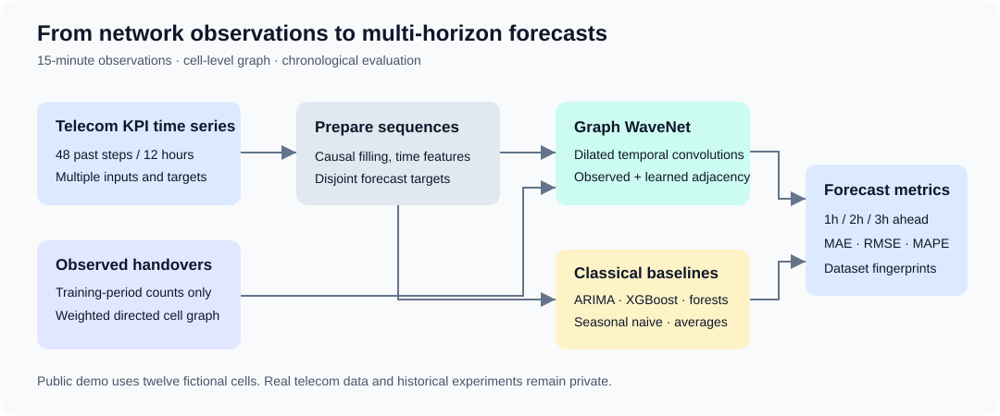
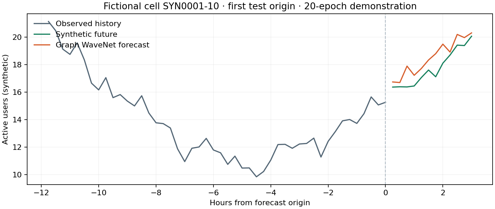

# st-celltower-forecasting

Spatio-temporal forecasting framework for telecommunications network KPIs. Network cells are represented as a graph derived from observed handover relationships, enabling Graph WaveNet to model temporal and spatial dependencies jointly, with classical forecasting methods as comparison baselines.

The task is multivariate forecasting at **15-minute resolution**: 48 past observations
(12 hours) predict the next 12 observations (3 hours), evaluated at **1h / 2h / 3h**.
The public demo uses 12 entirely fictional cells. Private telecom data and real-data
benchmark results are not distributed.



## Quick start: no private data required

Use Python 3.9–3.11. From the repository root:

```bash
python3.11 -m venv .venv
source .venv/bin/activate
python -m pip install torch==2.0.1 --index-url https://download.pytorch.org/whl/cpu
python -m pip install -r requirements.txt
python -m pip install --no-deps -e .
python main.py --demo
```

The demo generates six days of fictional KPI observations and handovers, constructs
a graph from the training period only, preprocesses the data, and trains a small
Graph WaveNet for five epochs on CPU. Generated data and results are ignored by Git.
A one-epoch smoke test is `python main.py --demo --epochs 1`.

To reproduce the longer six-model demonstration below:

```bash
python main.py --demo --models historical_average seasonal_naive random_forest xgboost arima graph_wavenet --epochs 20
```

The dependency pins match the locally tested environment; they are not a complete
transitive lock file or a claim that every package is the latest release. CPU is
sufficient. For CUDA, install a compatible PyTorch build and driver; `device: auto`
selects an available GPU or falls back to CPU. The project is run from a source
checkout; editable installation keeps its configuration files available.

## Inputs, targets, and graph

| KPI | Meaning | Demo role |
| --- | --- | --- |
| `MAX_DL_ACTIVE_UE` | Maximum active downlink users | Input and target |
| `DL_USER_THPUT_KBPS` | Downlink user throughput, kbit/s | Input and target |
| `PERC_USE_PRBS_DL` | Downlink resource-block utilization, % | Input |

Five cyclic/calendar features supplement these KPIs. Target and input lists are
configurable. Arrays have shapes `X = (windows, 48, cells, features)` and
`Y = (windows, 12, cells, targets)`.

Handover events between cells are aggregated into a **weighted directed graph**.
An edge `source → target` has the sum of observed handover counts, so edges
represent network interactions rather than geographic proximity alone.
The graph builder filters events to the training interval before aggregation,
drops self-loops and zero-weight edges, and preserves listed isolated cells.
Optional incoming/outgoing quantile pruning is disabled by default.
Graph WaveNet uses forward/reverse transition supports plus an optional learned
adaptive adjacency. The baseline models do not consume the handover graph.

The runnable graph example is in [01_graph_construction.ipynb](notebooks/01_graph_construction.ipynb).
Full column contracts and data shapes are documented in [data/README.md](data/README.md).

## Models and evaluation

Graph WaveNet combines dilated temporal convolutions and graph convolutions.
The adapted implementation is based on LibCity, with architecture and utilities
originating in [Graph WaveNet (Wu et al., IJCAI 2019)](https://arxiv.org/abs/1906.00121).
Source provenance and upstream licenses are in [THIRD_PARTY_NOTICES.md](THIRD_PARTY_NOTICES.md);
the exact original adaptation revision was not recorded.

Five baselines share the same sequence contract:

- Historical average: training means per cell, weekday, and 15-minute slot;
  unseen slots fall back to the cell's training mean.
- Seasonal naive: repeat the previous day's observation, with persistence fallback
  when that timestamp is unavailable. Earlier validation/test observations may be
  used as history, never future targets.
- Random Forest: direct multi-output regression, pooling cells and using past KPI
  histories plus available static cell features.
- XGBoost: direct regression for each output step and target, with validation-based
  early stopping.
- ARIMA: fit parameters on each cell/target's training series, then condition each
  forecast on its observed input window.

Evaluation reports MAE, RMSE, and MAPE at steps 4, 8, and 12, aggregating across
forecast origins and cells. It does **not** average all steps up to each horizon.
MAPE excludes zero-valued targets and can be misleading near zero.

### Verified synthetic demonstration

These are execution results on the fictional six-day dataset, not a real-network
benchmark or evidence that one method generalizes better. Seed 42; CPU;
325 training / 85 validation / 85 test windows; Graph WaveNet trained for 20 epochs.
The short dataset lacks a full training week, which particularly limits the
weekday-based historical average.

MAE for `MAX_DL_ACTIVE_UE` (synthetic active users):

| Model | 1h | 2h | 3h |
| --- | ---: | ---: | ---: |
| Historical average | 4.368 | 4.535 | 4.636 |
| Seasonal naive | 0.753 | 0.752 | 0.754 |
| Random Forest | 0.640 | 0.646 | 0.662 |
| XGBoost | 0.590 | 0.593 | 0.596 |
| ARIMA | 1.324 | 2.284 | 3.184 |
| Graph WaveNet | 1.442 | 1.459 | 1.250 |

Complete MAE/RMSE/MAPE values for both targets, effective model settings, software
versions, and dataset hashes are in [assets/demo_metrics.json](assets/demo_metrics.json).
The report exporter recomputes metrics from verified prediction archives before
creating this public summary. Numeric results may vary across devices/libraries.



The curve shows the first fictional cell at the first test forecast origin, not
a selected best-performing example.

## Run with your own authorized data

Real telecom data is not included, and redistribution rights must not be assumed.
Place authorized `CELL_*.csv` observations in `data/raw/` and handover events in
an ignored local directory. Copy `configs/experiment_example.yaml` to
`configs/experiment.local.yaml` and set dates, KPIs, and data/output paths.
Configuration paths are resolved relative to the project root; CLI paths are
resolved relative to the calling directory. No working-directory change or
scheduler-specific setup is required.

Build a graph using **only your configured training dates**, then preprocess:

```bash
python -m src.graph --input data/raw/HO_events.csv --cells-file data/raw/CELL_observations.csv --train-start 2025-01-01 --train-end 2025-02-01 --output data/processed/handover_graph.pkl
python -m src.preprocessing --config configs/experiment.local.yaml
python main.py --config configs/experiment.local.yaml
```

Graph construction accepts a generic `handover_count` or the documented vendor
counter columns. Only load graph pickle files you trust. Set `graph_path` in the
model config, use an experiment `model_overrides.graph_wavenet.graph_path`, or pass
`--graph-path`.

Useful experiment options are `--models`, `--device`, `--epochs`, `--batch-size`,
`--data-dir`, `--dataset-id`, `--output-dir`, `--num-workers`, `--sample-limit`,
and `--weight-alpha`. For example:

```bash
python main.py --config configs/experiment.local.yaml --device cpu --epochs 1 --sample-limit 4
python main.py --config configs/experiment.local.yaml --models historical_average seasonal_naive random_forest xgboost
```

A sample-limited run checks execution, not full-dataset accuracy. ARIMA seasonal
fits and full tree runs can be expensive. The default `python main.py` uses the
private-data example config; use `--demo` for an immediately runnable public example.

## Reproducibility and analysis

Date partitions are start-inclusive/end-exclusive. Every target in a window must
fit inside its partition; boundary-crossing windows are dropped. Input history
can precede the partition, as in an operational forecast. Without date boundaries,
ratio splits purge overlapping forecast targets. Missing values are forward-filled
from past observations only, and initial gaps become zero. Metrics currently
include imputed targets; a missing-target evaluation mask is a future improvement.

Preprocessing creates immutable, uniquely named dataset folders with SHA-256
manifests. Prediction archives snapshot metadata and their original dataset hashes;
analysis rejects altered datasets and unverifiable legacy predictions. Keep the
original generated dataset beside saved predictions. Seeds apply to Python,
NumPy, and PyTorch; exact cross-platform reproducibility is not guaranteed.

Ordinary MSE is the default (`weight_alpha: 0`). Optional weighting uses fixed
training-only, per-target normalization statistics. Validation is deterministic
and aggregates weighted error independently of batch grouping; early stopping
restores an independent best-epoch snapshot.

Set `experiment.save_model_checkpoints: true` to save checkpoints. Graph WaveNet
checkpoints include scalers, adjacency, and weighting statistics and can be loaded
on CPU without the original graph file:

```python
from pathlib import Path
from models.graph_wavenet import GraphWaveNetModel

model = GraphWaveNetModel.load(Path("results/checkpoints/example.pt"), device="cpu")
```

For output-free notebooks, install `requirements-notebooks.txt` and select the
same Python environment. [03_results_analysis.ipynb](notebooks/03_results_analysis.ipynb)
loads the latest demo Graph WaveNet predictions and verifies their dataset.

## Project layout

```text
configs/         Private-data template, runnable demo, six model configs
models/          Graph WaveNet, common interface, sequence baselines
src/             Graph/data preparation, immutable datasets, experiment pipeline
notebooks/       Graph construction, data exploration, verified result analysis
tests/           Regression tests with fictional data
data/            Data contract and tiny hand-written synthetic schema fixtures
assets/          Architecture, synthetic forecast, verified synthetic metrics
scripts/         Public-file/history audit, clean export, verified report export
third_party/     Retained upstream licenses
.github/         Unit-test and one-epoch synthetic-demo CI
```

Run checks with:

```bash
python -m unittest discover -s tests -v
python scripts/audit_public.py
git diff --check
```

CI is configured for Python 3.10 and 3.11; its hosted runs start after a push.
Local checks cover loss edge cases, early stopping, checkpoint round trips,
causal preprocessing, split boundaries, baseline contracts, artifact provenance,
synthetic generation, and directed graph aggregation.

## Public release and license

Before publishing, read [docs/PUBLIC_RELEASE.md](docs/PUBLIC_RELEASE.md).
The research repository's **old Git history still contains private paths, cell
identifiers, and cached notebook outputs**. Cleaning current files does not remove
that history. Create a reviewed source export and a **new** public repository;
do not simply change the research remote's visibility.

Original project components use [MIT](LICENSE). The adapted Graph WaveNet module
retains Apache-2.0 and original Graph WaveNet MIT notices as described in
[THIRD_PARTY_NOTICES.md](THIRD_PARTY_NOTICES.md).
